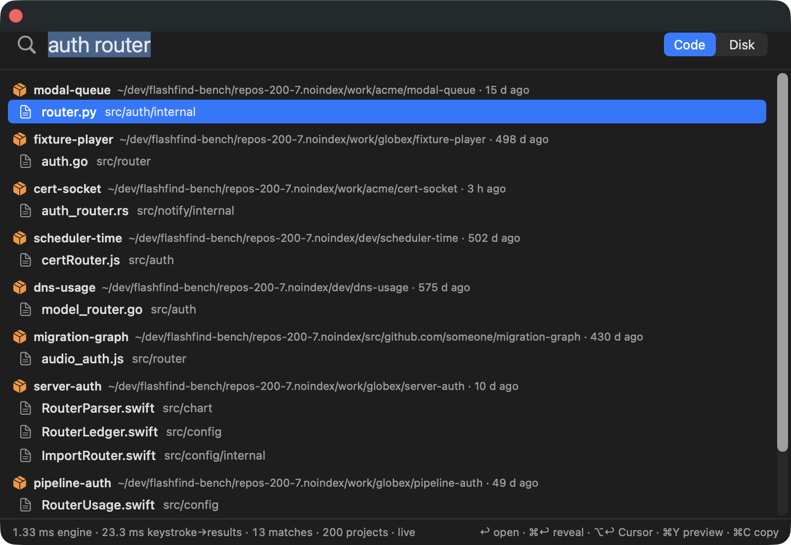
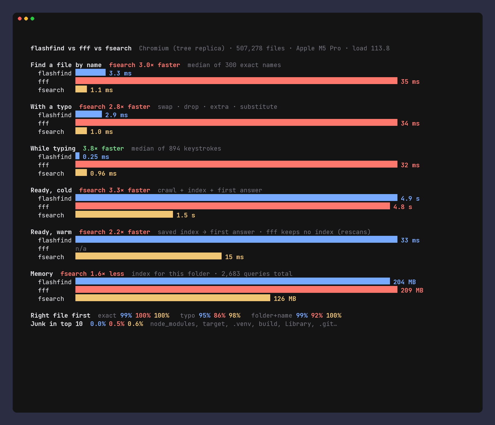
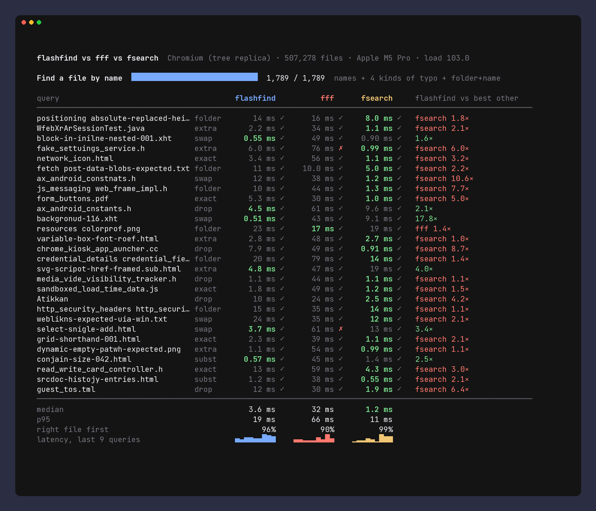

# flashfind

**Find anything across all your code projects, instantly, for you and your
AI coding agent.**

flashfind discovers every git repository under your home folder and builds
one index of what is actually *in* them: `.gitignore` is honoured and
`node_modules`, `target`, `build`, `dist`, `DerivedData`, `.venv`, `Pods`,
`.git` internals and the like are left out. Then it answers fuzzy,
typo-tolerant file-name queries across all of them in well under a
millisecond, grouped by repo, with recently active repos first. It does this
from the command line, as JSON, or as an **MCP server** that Cursor, Claude
Code and other agents can call instead of running `find`/`ls` on every repo.

Underneath is a general whole-disk file-name engine for macOS (portable to
Linux) built to be linked in-process and queried on every keystroke, with
live FSEvents updates. That engine is a re-engineering of
[fsearch](https://github.com/noahdunnagan/fsearch); see Credits.

> **Status: early, works, tested on Linux and macOS (Apple Silicon).** Code
> projects mode (discovery, gitignore-aware index, `repo:`/`lang:`/`dirty:`,
> CLI, MCP) follows file changes live (FSEvents, ~30 ms change-to-searchable
> on a real 323-repo home). There is a small macOS demo app over the C API
> ([FlashFind.app](#flashfindapp-macos-demo)). No content search yet. Not on
> crates.io.



## Credits

flashfind stands on two MIT-licensed projects. Full license texts are in
[THIRD_PARTY_NOTICES.md](THIRD_PARTY_NOTICES.md).

- **[fsearch](https://github.com/noahdunnagan/fsearch) by Noah Dunnagan**: the
  main inspiration and the baseline it is benchmarked against.
  - *Code adapted:* the macOS `getattrlistbulk(2)` crawler
    (`crates/flashfind-core/src/walk/macos.rs`: attribute buffer parsing,
    `openat` fan-out over a rayon scope, the `setiopolicy_np` "don't download
    iCloud files" policy, raising the fd limit) and the file-type extension
    table behind `type:image|video|…`.
  - *Ideas:* interned distinct names with a character-class bitmask
    prefilter; a name → entries inverted list, so each distinct name is scored
    once; entries stored in depth-first order, so a folder is a contiguous
    range (`in:` scoping); location priors; narrowing the previous query's
    survivors while you type; the filter syntax (`ext:`, `type:`, `size:`,
    `mtime:`, `in:`).
  - `bench/fsearch-baseline` links upstream fsearch as a library to measure it.
- **[fff](https://github.com/dmtrKovalenko/fff) by Dmitriy Kovalenko**: no code
  copied. Ideas taken from it: the engine as an embeddable library with a C ABI
  (like `fff-c`) instead of a daemon behind a socket; typo tolerance that grows
  with query length (fff's matcher, frizbee); and a bigram prefilter (fff uses
  one for content search; flashfind uses a per-name bigram signature to skip
  names that can't be within the typo budget). frizbee itself is not used.
  fff's focus on *projects* (git-aware, project-scoped search for editors and
  agents) also shaped the code-projects mode.
- The code index uses the [`ignore`](https://crates.io/crates/ignore) crate
  by Andrew Gallant (MIT/Unlicense, the walker behind ripgrep) for
  `.gitignore` semantics.


The terminal benchmark (`bench/vs`) is modeled on fsearch's `demo/vs_fff.py` / `vs_fff_demo.py` (same query method and visual style). It links fff's `fff-search` crate and fsearch's library, both unmodified, only in that separately built harness.

## Code projects

```sh
cargo build --release      # Rust 1.88+
FF=./target/release/flashfind

$FF projects                          # every repo under ~, most recently active first
$FF code router                       # fuzzy file/folder name search across all repos
$FF code auth middleware              # folder + name: matches src/auth/middleware.ts
$FF code 'repo:api lang:ts router'    # one project (exact, prefix or substring of its name), TypeScript only
$FF code dirty: lang:rust             # files with uncommitted changes (runs git status in the matched repos)
$FF code --recent 2d                  # most recently modified files across repos
$FF code --json 'invoce'              # compact JSON grouped by repo (typo-tolerant)
```

`flashfind code` output is grouped by repo:

```
payment-vault  (~/work/globex/payment-vault, 2h ago)
    src/signer/token.go
model-retry  (~/oss/model-retry, 14d ago)
    src/signer/tokenForm.ts
```

- **Roots:** `--root DIR` (repeatable or comma-separated), or
  `FLASHFIND_CODE_ROOTS` (`:`-separated); default `~`. Discovery skips
  `Library`, `Applications`, media folders, hidden folders, `*.app` and the junk
  list, and it doesn't search inside a repo for more repos, so submodules are
  part of their parent.
- **What is indexed:** everything `git` would show, plus untracked files that
  aren't ignored. Hidden files such as `.github/` and `.env.example` are kept.
  Rules come from `.gitignore`, `.git/info/exclude`, the global excludes file
  and `.ignore`. Folders named `node_modules`, `target`, `build`, `dist`,
  `out`, `DerivedData`, `.build`, `.venv`, `venv`, `__pycache__`, `Pods`,
  `.gradle`, `.next`, `.turbo`, `.cache`, `coverage`, `.idea`, … are skipped
  even when not ignored (`--no-default-excludes` turns this off;
  `--no-gitignore` disables ignore files).
- **Ranking:** the usual flashfind score (exact > stem > prefix > word >
  substring > fuzzy > typo, folder parts of a multi-word query matched against
  parent folders), plus a small boost for repos active in the last day, week,
  month or half year. The repo's last activity is the later of its last
  commit (read from `.git/logs/HEAD`, no git process) and `.git/index`.
  The boost only reorders results within a score band.
- **Filters** on top of the normal query language: `repo:<name>[,<name>]`,
  `lang:<rust|ts|js|py|go|swift|c|cpp|java|kotlin|ruby|php|cs|zig|lua|sh|md|…>`,
  and `dirty:`. The usual `ext:`, `type:`, `size:`, `mtime:`, `!exclude` and
  `=exact` work too.
- **Live:** the cache (`~/.cache/flashfind`, `FLASHFIND_CACHE`) is a base;
  changes land in small per-repo overlays (see [Live code index](#live-code-index)).
  `--refresh` rebuilds from scratch.

### MCP server (Cursor, Claude Code, …)

`flashfind mcp` speaks MCP over stdio and exposes:

| tool | arguments | returns |
|---|---|---|
| `find_files` | `query`, optional `repo`, `lang`, `dirty`, `limit` (20) | `{total, groups:[{repo, root, files:[paths relative to root]}]}` |
| `list_projects` | optional `filter`, `limit` (50) | `{total, projects:[{name, root, branch, last_commit, active, entries}]}` |
| `recent_files` | optional `repo`, `lang`, `within` (`7d`), `limit` | same shape as `find_files`, newest first |
| `reindex` | – | rediscover and rebuild now |

The index is loaded from the cache (or built) at startup, caught up with a
folder-mtime recheck, and then follows FSEvents live, so an agent sees a file
it just created on its next call. Results list each repo root once, with
paths relative to it, to keep agent context small.

**Cursor:** add to `~/.cursor/mcp.json` (or `.cursor/mcp.json` in a project):

```json
{
  "mcpServers": {
    "flashfind": { "command": "/absolute/path/to/flashfind", "args": ["mcp"] }
  }
}
```

**Claude Code:**

```sh
claude mcp add flashfind -- /absolute/path/to/flashfind mcp
# limit it to some folders:
claude mcp add flashfind -- /absolute/path/to/flashfind mcp --root ~/dev --root ~/work
```

Any other MCP client works the same way: the command is `flashfind mcp`.

### Live code index

The code index reuses the whole-disk engine's live machinery, at repo
granularity:

- **Base + overlays.** The cached index is the base. A change inside a repo
  re-walks that repo (gitignore-aware, same junk list) into a small overlay
  index built under the base root, so paths and scores line up, and
  tombstones the repo's base range. Searches merge base + overlays. Re-walking
  one repo takes about 5–15 ms; a batch's repos are re-walked in parallel.
- **What counts as a change.** Events inside junk folders (`node_modules`,
  `target`, …) are dropped, and so are `.git` internals unless `.git`
  disappears. Editing `.gitignore` re-walks the repo, so new rules apply at
  once. An event outside every repo checks that folder and its children for
  new repos (`git clone`, `git init`) and drops known repos that are gone.
  Hidden folders, `Library`, `*.noindex`, `__MACOSX` and OrbStack mounts never
  become projects.
- **Lost history** (`MustScanSubDirs`, dropped events) inside a repo re-walks
  it; outside repos it triggers a full rebuild.
- **Compaction** is a background full rebuild (discover + crawl, ~5 s for
  323 repos) that swaps in a new base, saves it, and re-applies events that
  arrived meanwhile. It runs past 64 overlaid repos or every 30 min while
  overlays exist.
- **Catch-up on open.** The FSEvents id from before each crawl is saved with
  the cache, and the watcher (MCP server, app) replays from there in the
  background. Short-lived processes (`flashfind code`, app launch) first run
  a parallel **recheck**: stat every indexed folder and treat changed or
  missing ones as events. A busy home folder produces ~10k FSEvents a minute,
  so replaying history took ~3.7 s; the recheck takes 70–600 ms depending on
  load. The recheck sees added, removed and renamed entries, not in-place
  file edits. The watcher does see those.
- Elsewhere than macOS the watcher is a periodic rebuild (default 300 s).

Measured on the real home index (323 repos, 235k entries, Apple M5 Pro).
`flashfind bench-live-code --dir <a folder in an indexed repo>` creates,
renames and deletes temp files there, waits until each change is searchable,
then cleans up:

| change → searchable (n=10 each) | p50 | max |
|---|---|---|
| create | 29–32 ms | 0.58–0.76 s |
| rename | 31–33 ms | 0.11–0.17 s |
| delete | 31 ms | 35 ms |
| search with overlays present (`readme`) | 0.42–0.49 ms | 1.8–3 ms |

The p50 is FSEvents' 30 ms coalescing latency plus a ~5 ms re-walk. The
machine had a load average of ~50 from unrelated work during these runs, and
other repos were changing at the same time (275–287 re-walks per run): the
max is a change queued behind such a batch. In an earlier run at load ~400,
p50 rose to 90–120 ms with 5–9 s outliers; that is what led to the parallel
re-walk. The macOS FSEvents test in `crates/flashfind-code/tests/live.rs`
measures p50 30 ms, max 44–62 ms on a temp tree.

### Code benchmark (Apple M5 Pro, synthetic 200-repo home)

`bench/run-code.sh` generates 200 repos (Rust, TS, JS, Python, Swift, Go)
with sources plus realistic junk (`node_modules`, `target`, `.venv`,
`.build`/`DerivedData`, `.git` objects, gitignored logs) and 20 k files under
`Library/`. Then it compares the code index with a plain index of the same
folder. Both use the same engine. Full table: [bench/CODE_RESULTS.md](bench/CODE_RESULTS.md).

| | code index | plain whole-tree index |
|---|---|---|
| entries indexed | 30.6 k | 271.5 k (**88.7% junk/ignored**) |
| index size | 1.6 MB | 13.4 MB |
| discover + crawl + build | 20 + 69 + 51 ms | 868 ms |
| junk in the top 10 results | **0%** | 32–54% |
| query p50 / p95 (bare name) | **219 µs / 1.33 ms** | 559 µs / 8.88 ms |
| `repo:<name> <stem>` hit@1 | **94%** | 50% (no repo filter) |
| folder + name hit@1 | 88% | 89% |

Caveats: the machine was very busy (load average 85–143), so treat the latency
as indicative. Bare-name hit@1 is only about 51% for both because the
synthetic vocabulary repeats file names across repos (hit@10 is 84–89%).
These are flashfind's own synthetic data and queries. Real homes haven't been
measured; on the Mac, discovery was only run on the synthetic tree.

## Whole-disk engine

### What is different from fsearch

| | fsearch | flashfind |
|---|---|---|
| Process model | daemon + Unix socket; FinderSearch adds a `stdio` child process and a 150 ms debounce | library linked into the app (`flashfind-ffi`), one call per keystroke, cancellable from any thread |
| Typos | 1 edit for words of 5+ letters; first letter must match | 1 edit at 5–8 bytes, 2 at 9+, **anywhere** incl. the first letter; adjacent swaps count as one edit (bit-parallel Damerau/OSA, Myers–Hyyrö) |
| 1–3 letter queries | score every name | answered from a sorted-name prefix range, stopping early once no remaining name can enter the page; result proven identical to a full scan, else it falls back |
| Typing | narrows from the last query | keeps 8 recent survivor sets (so backspace is cheap too) |
| Typo work | always | skipped when clean matches already fill the page above any possible typo score |
| `mtime:3d` | 1-second window (bug) | "within 3 days" |
| `mtime:>140y` | u32 wrap-around (bug) | saturating i64 arithmetic |
| Paths deeper than 256 levels | truncated (bug) | no depth limit |
| Sizes / mtimes | u32 (sizes lossy above 2 GiB) | 32 bits each: sizes exact below 2 GiB, MiB granularity above (to 2 PiB); mtimes unsigned seconds (1970–2106); filter arithmetic in i64 |
| Results | full list | top-k first page, with exact or lower-bound total |

### Benchmarks (Apple M5 Pro, 1.1 M-entry synthetic tree)

Both engines run in-process, on the same tree and queries, through their
library APIs. Full table and method: [bench/RESULTS.md](bench/RESULTS.md).
"previous" is the last published flashfind run (the older `FFIDX004`
index format). Both runs were on a busy machine.

| | flashfind now | flashfind previous | fsearch (this run) |
|---|---|---|---|
| all queries p50 / p95 / p99 | **393 µs** / 2.64 ms / 5.72 ms | 472 µs / 2.81 ms / 6.94 ms | 570 µs / 3.41 ms / **4.82 ms** |
| per keystroke (typing a name) p50 / p95 | **129 µs / 2.24 ms** | 156 µs / 2.64 ms | 792 µs / 3.78 ms |
| 1 / 2 / 3-letter queries p50 | **952 / 401 / 186 µs** | 1.06 ms / – / – | 3.08 / 2.85 / 1.79 ms |
| exact / stem / typo p50 | 408–680 µs | – | **476–526 µs** |
| exact / stem / typo p95 | 1.2–2.4 ms | – | **0.6–0.9 ms** |
| multi-word (folder + name) p50 / hit@1 | 3.15 ms / **100%** | – / 95% | **1.78 ms / 100%** |
| typo in first letter, hit@1 | **100%** | 100% | 0% (by design) |
| typo_drop hit@1 | 90% | 90% | **97%** |
| crawl (getattrlistbulk) | 15.5 s | 15.6 s | 15.6 s |
| index build | 435 ms | 550 ms | **211 ms** |
| index file | 66 MB | 106 MB | **56 MB** |
| RSS while querying | 104 MB | 133 MB | **94 MB** |
| file change → searchable (FSEvents) | p50 30 ms, max 90 ms | no live updates | not measured |

Read these numbers with care:

- **Where flashfind is worse:** its p95 on single-word name and typo queries
  is 1.2–2.4 ms against fsearch's 0.6–0.9 ms, and at p50 they are about even.
  Multi-word queries are now as accurate as fsearch (100%) but 1.8× slower,
  because of the new per-folder token scoring. The index is still 18% larger,
  RAM is 11% higher, the index build is 2× slower, and dropped-letter typos
  hit@1 is lower (90% vs 97%).
- **Where it is better:** short and prefix queries (3–15× faster), filters,
  typing latency (6× lower p50), first-letter typos, live updates, and search
  during the first crawl.
- **Compared with the previous run:** the index is 38% smaller (106 → 66 MB),
  query RSS is 22% lower (133 → 104 MB), and the multi-word hit@1 went from
  95% to 100%. fsearch measured about 2× faster this run than last time
  (p50 570 µs vs 1.11 ms) on the same tree. That fits the machine load
  changing (load average 47–121 now vs 60–170 then), so compare columns
  within a run rather than across runs.
- **Synthetic data:** names are far more unique than on a real disk. This is
  an engine comparison, not a whole-disk prediction. fsearch's socket/CLI
  round trip is not included.

### Live index

`Live` keeps the mmap'd base index and adds an in-memory overlay plus
tombstones. Changed folders are relisted (FSEvents on macOS, gives folder
granularity; mtime polling elsewhere) and queries search base and overlay
together. When the overlay passes a threshold or a timer fires, it is
compacted into a new base and saved. When event history is lost
(`MustScanSubDirs`, dropped events, a root change), folder mtimes are
re-checked instead of recrawling. The last event id is saved in the index
header, so a restart replays only newer events. While the first crawl runs,
queries are answered from the partial listings (with a progress indicator).

```sh
$FF watch ~/Documents              # crawl, watch, answer one query per stdin line
```

C API: `ff_live_crawl` / `ff_live_open`, `ff_live_watch`, `ff_live_progress`,
`ff_live_session_new` + `ff_search`, `ff_live_checkpoint`.

### Use

```sh
$FF index ~/Documents -o ~/.flashfind/index.ffx   # or / with Full Disk Access
$FF search 'invoce ext:pdf mtime:<30d'
$FF search --explain --limit 20 'q3 reprot'
$FF help query
```

Query language: plain words are fuzzy and must all match the name or a parent
folder; `'x` substring, `^x` prefix, `x$` suffix, `=x` exact, `!x`/`-x`
exclude; filters `ext:` `type:` `size:` `mtime:` `in:` `limit:`.

### Embedding (C / Swift)

`crates/flashfind-ffi` builds `libflashfind.a` / `.dylib`; the header is
[`crates/flashfind-ffi/include/flashfind.h`](crates/flashfind-ffi/include/flashfind.h).
Open an index (mmap, ~3 ms for 1.1 M entries) or a live index, create one
session per search field, and for each keystroke cancel the previous token
and call `ff_search` on a worker thread. See `crates/flashfind-ffi/examples/smoke.c`.

Code projects: `ff_code_open(roots, cache_dir, &err)` (NULL, NULL = home,
default cache), `ff_code_watch`, `ff_code_session_new`, then
`ff_code_search(session, "repo:x lang:rust auth", limit, cancel, cb, ctx, &err)`.
It delivers hits grouped by repo (`path`, `rel`, `repo`, `repo_root`,
`group`, `repo_active`, …). Also `ff_code_projects_json`, `ff_code_get_stats`
and `ff_code_checkpoint`.

## Benchmark vs fff and fsearch



`flashfind bench-vs` is a live terminal race modeled on
[fsearch's benchmark vs fff](https://github.com/noahdunnagan/fsearch/tree/main/demo).
fsearch's method: `demo/vs_fff.py` picks 300 unique names plus 4 typos each,
and `demo/vs_fff_demo.py` + `vs_fff.tape` record the side-by-side video.
flashfind, fff (its Rust core, `fff-search`) and fsearch (its library) run in
one process, on the same folder and queries, warm, taking turns going first.
The race shows each query live, with the winner's time in green, a ✓/✗ for
"right file first" and flashfind's speedup (or loss) against the best other
engine. Then it shows an animated summary card and a p50/p95/p99 table.

```sh
bench/vs.sh repos                 # synthetic 200-repo tree (node_modules, target, .venv…)
bench/vs.sh linux                 # shallow clone of torvalds/linux
bench/vs.sh chromium              # shallow clone of chromium/chromium (several GB)
REPLICA=1 bench/vs.sh chromium    # tree replica: exact paths + real .gitignores, empty files (~20 MB download)
bench/vs.sh ~/some/folder "label" -- --cast run.cast --md out.md --json out.json
python3 bench/vs/render.py run.cast out.png [--marker race] [--mp4 out.mp4]   # pip install pyte pillow
```

`bench/vs.sh` builds `bench/vs` (cargo fetches fff at a pinned rev; fsearch
is used from `../fsearch` and cloned there if missing). It installs nothing
system-wide. fsearch is macOS-only, so on Linux the race is flashfind vs fff.

Median latency (Apple M5 Pro, macOS 26.5.1, **heavily loaded machine**, see
[bench/VS_RESULTS.md](bench/VS_RESULTS.md) for p95/p99 and method):

| dataset | query | flashfind | fff | fsearch |
|---|---|---|---|---|
| Chromium tree, 507k files | exact name | 3.3 ms | 35 ms | **1.1 ms** |
| | with a typo | 2.9 ms | 34 ms | **1.0 ms** |
| | per keystroke | **0.25 ms** | 32 ms | 0.96 ms |
| | typo → right file first | 95% | 86% | **98%** |
| | ready cold / memory | 4.9 s / 204 MB | 4.8 s / 209 MB | **1.5 s / 126 MB** |
| Linux tree, 96k files | exact / typo | 0.25 / 0.25 ms | 1.9 / 1.8 ms | **0.19 / 0.18 ms** |
| | per keystroke | **0.12 ms** | 1.8 ms | 0.22 ms |
| 200 repos + junk, 48k files | exact / typo | **0.14 / 0.12 ms** | 1.9 / 1.7 ms | 0.34 / 0.30 ms |
| | per keystroke | **0.19 ms** | 2.2 ms | 0.57 ms |
| | junk in top 10 | **0%** | 5% | 29–43% |
| | `repo:` queries | **0.16 ms, 100% first** | – | – |

Where flashfind loses:
- **fsearch is about 3× faster per one-shot name query on one big repo**, and
  also builds its index about 3× faster with about 40% less memory there.
  flashfind's code engine pays for repo mapping and project-aware ranking on
  every query.
- **fff starts slightly faster and uses a little less memory** on the
  multi-repo tree.
- **Typo top-1 on Chromium is 95%**, behind fsearch's 98%.

Where flashfind wins:
- **Typing**: incremental narrowing makes each keystroke cheaper than a fresh
  search.
- **Many repos at once**: gitignore-aware, no junk, `repo:` filters.
- **fff in every latency row** (about 10×).



## FlashFind.app (macOS demo)

A launcher-style SwiftUI + AppKit app (macOS 15+) in `apps/macos`. It links
the Rust core **in-process** as a static library through the C ABI: no helper
process, no socket.

```sh
scripts/build-app.sh          # cargo build + swift build → dist/FlashFind.app (ad-hoc signed)
open dist/FlashFind.app
```

- Menu-bar item (no Dock icon). **⌃⌥Space** shows or hides the window from
  anywhere (Carbon hot key, no Accessibility permission needed).
- Searches on every keystroke. Each keystroke cancels the previous search's
  token, and the search runs on a worker queue. The status line shows engine
  time and keystroke→results time (typically 1–3 ms and 2.5–5 ms on the real
  323-repo index).
- **Code** mode groups results by repo (most recently active first) and
  takes `repo:` / `lang:` / `dirty:`. **Disk** mode uses a saved whole-disk
  index at `~/.flashfind/index.ffx` if there is one, and otherwise explains
  how to build it (that needs Full Disk Access).
- ↑/↓ select · ↩ open · ⌘↩ reveal in Finder · ⌥↩ open in Cursor (the repo
  folder plus the file) · ⌘Y, or Space right after ↑/↓, Quick Look · ⌘C copy
  path (when no query text is selected) · Esc clear / hide · ⌘1 / ⌘2 mode.
- It shares the CLI/MCP cache (`~/.cache/flashfind`), catches up with a
  recheck on launch (70–600 ms, or a ~5 s crawl the first time) and follows
  FSEvents while open.
- Scriptable for checks: `--query Q`, `--roots A:B`, `--cache DIR`,
  `--window-id-file F`, `--snapshot PNG`, `--quit-after SECONDS`.

Known gaps: no app icon, no settings UI (the roots come from
`FLASHFIND_CODE_ROOTS` or `--roots`), no launch-at-login, and the hot key is
fixed. Space only previews right after arrow-key navigation, because the
search field needs spaces. The app is ad-hoc signed, not notarized.

### Reproducing the benchmarks

```sh
git clone https://github.com/noahdunnagan/fsearch ../fsearch   # next to this repo
bench/run.sh 1000000 42    # ~1.1 M files under ~/dev/flashfind-bench → bench/RESULTS.md
bench/run-code.sh 200 7    # 200 synthetic repos → bench/CODE_RESULTS.md
cargo test --release --workspace
```

## Layout

- `crates/flashfind-core`: crawler (`walk/`), index format (`index.rs`,
  mmap-able `FFIDX005`), matcher (`matcher.rs`), query parser (`query.rs`),
  engine (`search.rs`), live overlay + compaction (`live.rs`), FSEvents /
  polling (`watch.rs`)
- `crates/flashfind-code`: repo discovery, gitignore-aware code index,
  `repo:`/`lang:`/`dirty:`, grouping, live overlays (`live.rs`), MCP server (`mcp.rs`)
- `crates/flashfind-cli`: the `flashfind` binary
- `crates/flashfind-ffi`: C ABI
- `apps/macos`: FlashFind.app (SwiftPM; `scripts/build-app.sh`)
- `bench/`: run scripts, fsearch baseline harness, results
- `bench/vs`: `flashfind bench-vs` terminal race vs fff and fsearch (links both, built separately), `replica.py`, `render.py`

## Roadmap

Let the MCP server search file contents in the matched repos, recent-files
ranking from git history, refresh repo activity on commits without a
re-walk, close the p95 gap on name/typo queries and the multi-word slowdown,
app polish (settings, icon, notarization).

## License

MIT, see [LICENSE](LICENSE). Third-party notices are in
[THIRD_PARTY_NOTICES.md](THIRD_PARTY_NOTICES.md).
